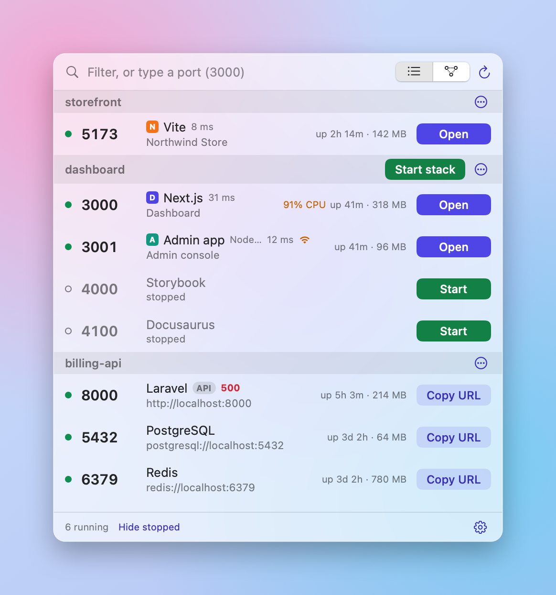

# Switchboard

**Every local port, with its project.**

<p>
  <a href="https://github.com/destucr/Switchboard/releases/latest"></a>
  <a href="https://github.com/destucr/Switchboard/releases"></a>
  <a href="https://github.com/destucr/homebrew-tap"></a>
  
  <a href="LICENSE"></a>
  <a href="https://github.com/destucr/Switchboard/stargazers"></a>
</p>

Switchboard sits in your Mac menu bar and shows everything running on localhost, grouped by the project it belongs to. Open it, restart it, read its logs or stop it without going back to the terminal.

Free and open source. [Website](https://destucr.github.io/Switchboard/) · [Download](https://github.com/destucr/Switchboard/releases/latest)

<p align="center">
  <picture>
    <source media="(prefers-color-scheme: dark)" srcset="docs/screenshot-dark.png">
    
  </picture>
  <picture>
    <source media="(prefers-color-scheme: dark)" srcset="docs/screenshot-map-dark.png">
    
  </picture>
</p>

<p align="center">
  <picture>
    <source media="(prefers-color-scheme: dark)" srcset="docs/screenshot-logs-dark.png">
    
  </picture>
</p>

## Features

- **Know what is running.** Every server, grouped by project. Vite, Next.js, Laravel, Django, Docker, Postgres, Redis and more. Web pages show their own title and icon.
- **The right button every time.** Open for web pages. Copy URL for APIs and databases.
- **Read logs without leaving.** Output follows live inside Switchboard. Filter it, copy it, or send it to the terminal you like, including a tmux or zellij session you already have open.
- **See what depends on what.** A map shows which servers talk to each other, and warns you before you stop one that others are using.
- **Pick up where you left off.** Stopped servers stay on the list. One click starts the whole project again, in the right order.
- **Share your setup.** Save a `switchboard.json` in your repo. A teammate adds the folder and presses Start stack.
- **No more "port already in use".** Type a port to see who has it. If a port is taken, Switchboard offers the next free one. You can also move a running server to another port, and undo it.

## Install

```sh
brew install --cask destucr/tap/switchboard
```

Or download the zip from [Releases](https://github.com/destucr/Switchboard/releases).

Switchboard is not notarized yet, so macOS asks you to confirm the first launch. Open System Settings, then Privacy & Security, and click Open Anyway. You can also run this once:

```sh
xattr -dr com.apple.quarantine /Applications/Switchboard.app
```

## How to read the map

Arrows point at the server being used. A solid line means Switchboard saw one of your servers, or a worker from your project, connected to another server on this Mac when it looked. A dashed grey line means the project's `.env` file names that port, but no connection was seen. That line starts from the project's server with the lowest port, which may not be the one that uses it. A red line means the server answers with an error (500 or above), or the `.env` file names a port where nothing is listening.

A missing line does not prove two servers are unrelated. A connection that is closed when Switchboard looks cannot be seen. The dashed box around servers is the project folder they share.

## Command line

The cask also installs a `switchboard` command for the terminal:

```sh
switchboard status [--json]    # what is running
switchboard export             # write switchboard.json from what you have run
switchboard start              # start the stack in order
switchboard stop               # stop it, front ends first
```

`switchboard.json` holds commands and dependencies only. Environment variables are never saved.

## Build

Needs macOS 14+ and Xcode or the Command Line Tools.

```sh
./build.sh install    # build, copy to /Applications, start
./scripts/check.sh    # build with no warnings, then the self-test
```

## Contributing

Run `./scripts/check.sh` before you send a change. Versions and the changelog are described in [RELEASING.md](RELEASING.md).

## License

MIT
